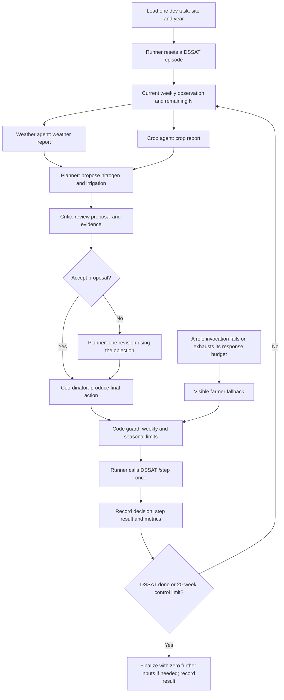
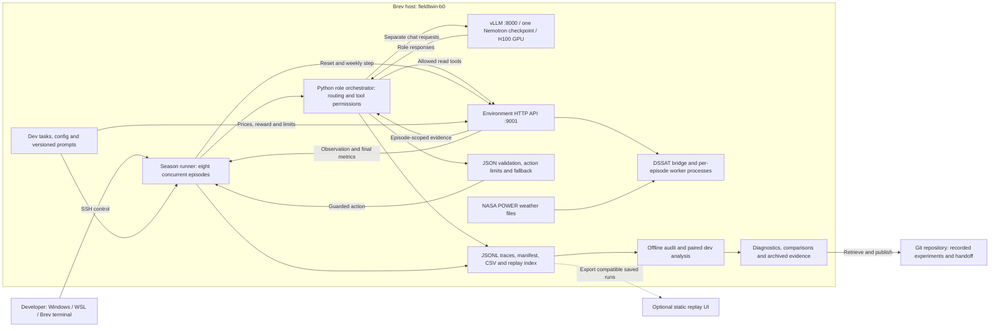
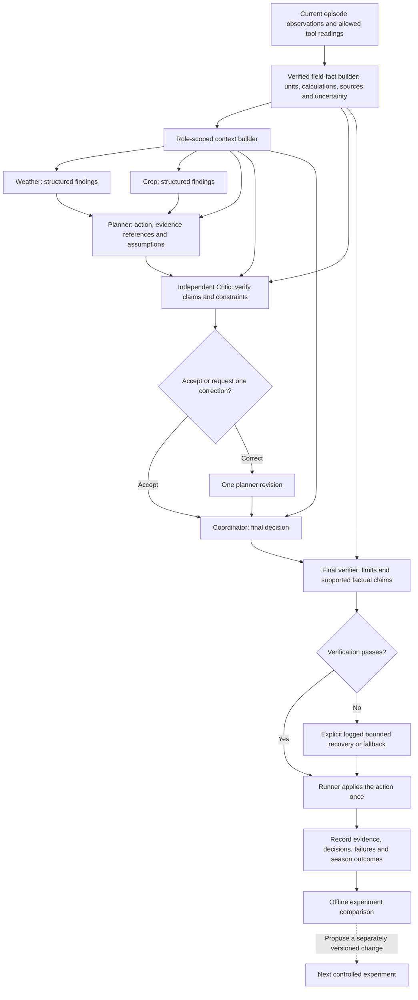

# FieldTwin: flowchart and high-level design

Implementation inspected at `d7c5cad` on `person-B`. The diagrams distinguish the
current implementation from the proposed next architecture. No new experiment or
runtime behavior is introduced by this document. See
[ARCHITECTURE_REVIEW.md](ARCHITECTURE_REVIEW.md) for the researched failure modes,
component retention criteria and proposed lean comparison arm.

## 1. Current weekly decision flow

This is the full `multi` policy. Weather and Crop run concurrently; later roles
receive the preceding outputs through the Python orchestrator.

- The failure branch can be taken from a role's model/tool loop. It covers bounded
  policy failures and HTTP failures during those calls. It is not a response to an
  ordinary critic objection: an objection triggers the one planner revision.
- Every model/tool invocation and message is logged as well as decisions/results.
- The runner alone advances the simulator. `submit_decision` in B's policies is
  an output channel, not a model-controlled call to `/step`.
- Environment reset/step errors abort the run; `/step` is never automatically
  retried because a timeout could occur after an action was already applied.
- Decisions end when DSSAT reports `done` or the server reaches its configured
  20-week control limit. At the limit, the DSSAT adapter's `final()` advances
  toward maturity with zero further inputs (bounded by 400 extra days). These
  days are not agent decisions. The archive audit found all 16 week-20 endings at
  R6 before day 140, supporting natural completion in those runs. Explicit
  end-reason/tail logging remains pending; the earlier description was incomplete.
- **Current limitation:** the critic reviews the planner before the coordinator.
  The final coordinator action gets code checks for limits, but no independent
  semantic review. The coordinator can introduce an error after the critic.

## 2. Current high-level architecture

The completed B dev experiments ran the Python application, simulator and model
server on the same Brev host. The Windows/WSL machine was used to develop, launch,
monitor and retrieve results over SSH.

The replay UI is a saved-run consumer, not the controller of the live experiment.
The native async experiment outputs need exporting to the UI's expected root
`runs/` paths/index. There is no deployed live multi-agent web dashboard.

### Component responsibilities

| Component | Responsibility | Current implementation |
|---|---|---|
| Experiment runner | Dev task selection, episode lifecycle, concurrency, logs and CSV | `fieldtwin_agents/runner.py`, `cli.py` |
| Shared team runner | Canonical Policy interface, baselines, evaluation and UI-compatible logs | `agents/run.py`, `eval/run_eval.py` |
| Policy adapter | Reuse B's async team from the shared synchronous Policy interface | `agents/policies/nemotron.py` |
| Orchestrator | Supply role contexts, route outputs, enforce tool access and bound revision count | `fieldtwin_agents/agents.py` |
| Model service | Serve the same frozen model weights for each role request | `fieldtwin_agents/clients.py`, `scripts/serve_vllm.sh` |
| Environment service | Own episode state, tools, action application, money/reward calculation | `env/server.py` |
| DSSAT workers | Simulate crop growth and losses using the selected real weather year | `env/dssat_sim.py`, `dssat_worker.py` |
| Audit and analysis | Validate complete logs/results, inspect worst cases and compare paired changes | `fieldtwin_agents/validation.py`, `evaluation.py` |
| Critic diagnostic | Check expected accept/reject behavior on controlled review fixtures | `scripts/check_critic.py` |
| Replay UI | Visualize exported saved season traces | `ui/` |

A's `gym_env/` is an additional existing NeMo Gym adapter to the environment API.
It is a separate rollout path, not the five-role orchestrator used in B's completed
experiments. An evaluation environment does not itself update model weights.

## 3. Communication and isolation

Each role invocation has its own system prompt, message list and allowed tools.
Its conversation continues inside its bounded tool loop, then returns a result to
the orchestrator. Agents do not communicate by accessing each other's KV state.

| Role | Read tools | Output routed onward |
|---|---|---|
| Weather | `get_weather` | Text report to Planner, Critic and Coordinator |
| Crop | `get_crop_state` | Text report to Planner, Critic and Coordinator |
| Planner | `get_soil`, `get_history` | JSON action proposal to Critic/Coordinator |
| Critic | `get_budget`, `get_soil` | JSON acceptance or one objection |
| Coordinator | All five read tools | Final JSON action to the runner's guard |

Planner and Coordinator can use `submit_decision` to return their action. Tool
arguments for environment reads are empty; the runner binds the episode ID. This
prevents the model from choosing another season's episode through tool arguments.

The planner revision receives the earlier proposal and critique. The coordinator
receives specialist reports, the critique and the latest proposal. Raw specialist
tool traces are logged but are not automatically copied to every other role.

Weather/Crop findings are currently prose inside a JSON context. They are not yet
typed, evidence-linked findings. Each new week starts fresh role conversations;
past environment actions/results can be read with `get_history`. There is no
persistent agent training or automatic cross-season learning.

### Model weights and cache

- All roles use one Nemotron checkpoint on one vLLM server. They are logical
  agents with separate contexts, not five separately trained model copies.
- vLLM prefix caching is enabled. The cache pool is shared; matching prompt-prefix
  computations can be reused across requests. This does not merge conversations.
- No per-role `cache_salt` is currently supplied. That is an available isolation
  option if a stricter prefix-reuse boundary is required.
- Logical role isolation, physical cache reuse and independence of reasoning are
  different properties. Sharing one model can produce correlated errors even
  when contexts are separated correctly.

Reference: [vLLM prefix caching](https://docs.vllm.ai/en/v0.27.1/features/automatic_prefix_caching/)
and [cache isolation design](https://docs.vllm.ai/en/v0.27.1/design/prefix_caching/).

## 4. Proposed next architecture — not implemented

The next proposal strengthens evidence and final-action verification. It does not
require five model servers or automatic model training.

Planned additions:

1. A verified field-fact builder: compute exact comparisons, budgets and totals;
   distinguish observed, estimated and forecast information. A farmer-rule flag
   describes that reference rule, not guaranteed optimal behavior.
2. Structured messages with evidence references, units and episode/week identity.
   Preserve both original/revised proposal IDs so critiques cannot be attached
   ambiguously to a later action.
3. A critic checked for both missed defects and false objections. Rejection count
   alone is not a measure of usefulness.
4. A verifier for the actual coordinator output. The precise checks and bounded
   recovery policy must be designed, versioned and evaluated before adoption.
5. A single experiment catalogue and runner wrapper, keeping good, bad and partial
   outcomes. Offline feedback proposes new versions; it is not automatic weight
   training or a demonstrated self-learning loop.

Any runtime/context/guard change must be distinguished from a prompt-only change
in the experiment protocol. Keep A's simulator, prices, reward and management caps
fixed during paired comparisons. A alone runs the held-out evaluation.

## 5. Deployment and operational boundaries

- Brev host: `fieldtwin-b0`; app snapshot `/ephemeral/fieldtwin/app-a-env`.
- Model API: `http://127.0.0.1:8000/v1`, H100 GPU, one BF16 checkpoint.
- DSSAT HTTP API: `http://127.0.0.1:9001`, CPU simulation workers.
- Both APIs bind to localhost; remote access uses SSH forwarding or a Brev shell.
- The remote app is a copied snapshot. A Git push does not deploy new code there.
- Each experiment reserves a new output directory; no automatic `/step` retries.
- Current shared default remains v1. v4/v5 are unpromoted critic candidates.
- At the latest experiment checkpoint, season experiments were complete and the
  model/simulator services were left running. Check live health before another run.

See [handoff.md](handoff.md) for completed results, artifact locations and exact
resume commands, and [TASKS_PERSON_B.md](TASKS_PERSON_B.md) for pending work.
