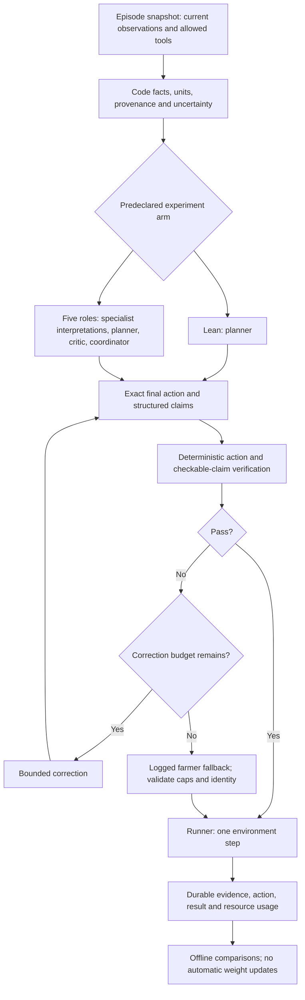

# FieldTwin architecture review

Reviewed October 17, 2026 against source at `eb93e3f`, recorded dev results and the
primary research/documentation linked below. This review does not change policy
behavior, deploy code, launch experiments or train weights.

## Decision

After A2 integration (`a866f06`), selected farmer practice is `farmer_ufga` at
1116.72 dev reward. The 1024.05 farmer below is the historical comparator;
multi v3 is 21.37% below the newly selected reference. See
[NEXT_STEPS.md](NEXT_STEPS.md) for updated priorities and thinking-mode design.
No runtime mode was changed.

The plan is good enough to continue as a controlled experiment. We have not yet
shown that five LLM roles are necessary, that the critic improves decisions, or
that our system beats farmer. Keep the five-role research arm, but compare it with
a lean planner using the same evidence, checks and compute allowance. Components
must earn their place through measured contributions.

Our best completed multi-agent dev run earns **878.04 versus farmer 1024.05
USD/ha** in the fixed simulator benchmark. Mean irrigation is **407.95 versus
111.25 mm**, with **74.99 versus 16.34 kg/ha** N leached. Higher yield did not
produce higher reward. These are 20 development years at one site, one stochastic
rollout per policy/year/version, not independent field validation.
See [results](results/b3-iterations.md).

Multi-agent research identifies specification, communication and verification
failures; controlled scaling research finds that benefits depend on task structure
and coordination overhead. These findings motivate our ablations; they do not
predict FieldTwin's outcome. [MAST](https://arxiv.org/abs/2503.13657v3),
[Scaling Agent Systems](https://arxiv.org/abs/2512.08296v3).

## Findings grounded in this repository

| Finding | Evidence | Consequence |
|---|---|---|
| Literal comparisons remain unreliable | Logged moisture 0.93 interpreted as satisfying a below-0.35 rule; critic diagnostics expose reversed stress meanings and incorrect cap comparisons | Compute exact facts in reviewed code; another natural-language reviewer is insufficient |
| Stronger critic wording can worsen review | v4 rejected all 6 expected-valid reviews; v5 rejected 4/6 while rejecting all 14 constructed bad reviews | Score false acceptance and false rejection; neither candidate is promoted |
| Final action can bypass the critic | `AgentTeam.decide`: planner review, optional revision, then coordinator produces another action | Check the exact executed action; preserve proposal/review lineage |
| Summaries can distort evidence | Weather/Crop return prose; downstream contexts do not automatically include raw specialist tool readings | Route typed facts alongside optional interpretations |
| Critique identity is ambiguous after revision | `context["proposal"]` is replaced while the earlier critique remains | Immutable proposal IDs; each objection identifies its target |
| Parallel error accounting depends on interleaving | Weather/Crop share `WeekState.malformed`; successful responses reset the counter | Per-invocation counters plus an explicit weekly total budget |
| Decision horizon differs from earlier HLD wording | Server ends on DSSAT done OR 20 weeks; `DssatSimulator.final()` then advances with zero inputs toward maturity, bounded by 400 days | Log stop reason and post-control simulation days/losses |
| Synthetic forecast has unusually favorable structure | Future realized weather plus noise; multiplicative rain noise preserves zero-rain days | Label it synthetic; test missed rain and false alarms separately |
| Soil N is estimated | Fixed initial N/mineralization assumptions in adapter mass balance | Mark it estimated and test sensitivity |
| Batch completion is a persistence boundary | Native runner writes CSV/index after `asyncio.gather`; JSONL is flushed during episodes | Persist each completed season immediately; recover tables without replaying actions |
| Push does not deploy | Brev app is a copied snapshot | Verify deployed source hashes before comparisons |

A read-only [audit of all 80 archived seasons](results/architecture-horizon-audit.json)
found 16 reaching decision week 20. All 16 end at R6, partway through that week
(135-138 days, below 140), supporting natural completion rather than a forced
20-week truncation. Final versus summed weekly leaching/gas differs by at most
0.03 kg/ha, consistent with rounding. There is no evidence here that the horizon
changed the reported rankings. Explicit end-reason logging remains worthwhile.

The audit also found unreconciled **N uptake** final-versus-weekly differences up
to 10.39 kg/ha in v1 and 6.23 in v3. The adapter uses final `wtnup` minus initial
`wtnup`, versus summed daily `trnu` for weekly uptake; definitions/timing need A's
review. Uptake does not directly enter the fixed reward formula. Do not declare
the cause or invalidate reward rankings from this discrepancy alone. Coordinate
any environment change with A and preserve the historical evidence.

## Component decisions

Every row gives a reason to exist, risk, mitigation and evidence needed to retain
the component. Proposed changes are not implemented yet.

| Component | Reason to include | Potential failure | Proposed solution | Keep/remove validation |
|---|---|---|---|---|
| DSSAT environment and episode workers | Common benchmark for delayed crop outcomes | Wrong units, stress direction, action timing, horizon or calibration rewards wrong behavior | Keep fixed benchmark; document adapter mappings and zero-input tail; expose completion reason; reconcile weekly/final metrics | Contract checks, no-input/farmer references, sensitivity analysis; simulation-only claims |
| Episode-scoped tool gateway | Supplies current field evidence without simulator-control authority | Stale readings, wrong episode or future-data leakage | Runner binds episode; one immutable weekly snapshot with episode/week identity and allowlist; only runner steps | Interleaved-episode tests show no cross-talk; allowed evidence available before decision |
| Deterministic fact builder | Dependable units, comparisons, budgets and totals | Shared wrong formulas become authoritative errors | Fixed reviewed functions; raw source/value, units, derivation and observed/estimated/forecast status; preserve uncertainty | Boundary/unit tests and reconciliation with raw tools; missing stays missing |
| Versioned domain reference | Supplies meanings and timing each role needs | Conflicting heuristics or unvalidated advice treated as laws | Small sourced contract for stress, units, caps, action timing and limitations; distinguish farmer rules from agronomic truth | Cross-role consistency; add retrieval only for demonstrated missing knowledge |
| Weather specialist LLM | Could interpret uncertainty and rain/fertilizer tradeoffs | Hallucinated rain or misleading summary; extra calls merely to sum numbers | Calculate totals in code; optional interpretation with evidence IDs and uncertainty alongside raw facts | Code-only facts versus LLM interpretation at matched budget; retain only for downstream benefit |
| Crop specialist LLM | Could interpret growth stage and stress for planning | Reversed stress factors, invented deficiency, estimated N treated as measured | Explicit scale metadata and stage dictionary; code computes literal facts; diagnosis cites evidence and qualifies uncertainty | Deterministic facts versus specialist interpretation; assess diagnosis errors and season reward |
| Planner | Selects N/water under uncertain future returns | Spends cap as target, chases yield, ignores season resource allocation | Remaining resources, prices, stage/history and facts; structured plan with assumptions and evidence IDs | Compare with farmer and evidence-matched single planner; report reward, inputs, losses and worst years |
| Critic | Could catch unsupported assumptions before execution | Correlated model errors, anchoring, false objections and over-rejection | Separate reviewer context; direct raw facts; structured rule/evidence/proposal IDs, severity and insufficient-evidence option | Fresh independently reviewed valid/invalid cases; both error rates; with/without critic seasons and actual revision benefit |
| Coordinator | Resolves conflicts in original five-role arm | Unchecked new action after a correct review; redundant planner cost | Test verified planner pass-through; if LLM retained, log action differences and verify final fields | With/without coordinator at matched compute; improve beyond deterministic selection |
| Final verifier | Checks exact action sent to simulator | JSON/limit compliance mistaken for agronomic correctness | Types, finite values, caps, episode/week, evidence identity and machine-checkable predicates; rerun after every change | Inject stale, over-cap, revised and contradictory actions; no universal ban on irrigation above farmer threshold |
| Python orchestrator and bounded revision | Explicit sequencing, permissions and termination | Loops, obsolete critiques, partial failures and interleaved counters | Fixed workflow, one revision, immutable IDs, per-call error state, time/token bounds | Trace checks cover each branch; no step before verification; no open-ended chat required |
| Shared Nemotron/vLLM | Separate role requests, one resident weights copy, batching opportunity | Queue overload, timeouts, correlated capability limits, insufficient reasoning | Pin model/container/settings; bound concurrency; record tokens and latency; test thinking mode separately | Same-evidence, matched-budget quality and serving benchmarks on actual hybrid model |
| Runner, action application and fallback | Owns advancement and defined recovery | Timeout retry applies twice; hidden fallback gets credited to agents; abandoned workers | Keep no automatic step retries; cap-check fallback and log cause; durable result receipts and cleanup before resumability | Crash/timeout tests, no replay of uncertain actions; fallback rates/outcomes visible |
| Ledger, audit and evaluation | Reproducible positive, negative and partial results | Winner's curse, source/environment drift, missing failures, stochastic variation | Unique run IDs; pinned source/model/data/inference; durable season results; declared comparisons and repeats; protect test | Rebuild tables from archives; report uncertainty, failed variants and compute |
| Replay UI | Human inspection and failure diagnosis | Attractive charts hide partial/failed runs or disagree with ledger | Read canonical catalogue; show completeness, version, fallback and raw evidence | Match audited numbers; optional and outside decision path |
| NeMo Gym / future SFT or RL | Separate rollout/training workflow if a capability gap warrants it | Confusing evaluation with learning; poor labels/reward, simulator exploitation, leakage | Defer until facts/evaluator/baselines reliable; separate train/dev/test and training budget | Actual weight updates plus independent evaluation before learning claim |

## Research support and limits

**Exact calculations.** PAL improves reasoning benchmarks by delegating execution
to an interpreter. Our narrower inference: reviewed fixed functions for our known
arithmetic, not arbitrary generated code. This does not validate any watering
threshold as optimal. [PAL](https://arxiv.org/abs/2211.10435v2).

**Reviewer reliability.** Intrinsic self-correction research finds failures without
external feedback; LLM-as-judge research documents reasoning limits and biases.
Neither proves our critic cannot help. Both argue against assuming a second prompt
is an independent authority; our false objections make that risk concrete.
[Self-correction](https://arxiv.org/abs/2310.01798v2),
[LLM-as-judge](https://arxiv.org/abs/2306.05685).

**Output form.** vLLM 0.27.1 supports JSON-schema constrained generation. Test
checkpoint/tool/reasoning-parser compatibility on final-output turns first.
Correct structure alone cannot establish factual truth or good management.
[Structured outputs](https://docs.vllm.ai/en/v0.27.1/features/structured_outputs/).

**Serving cache.** Prefix reuse saves repeated prefill work, not generation,
weights storage or five-role overhead. Separate request histories remain the
communication boundary. Optional `cache_salt` restricts prefix reuse to a trust
group; disabling reuse does not make reasoning independent. Measure actual savings.
[Prefix caching](https://docs.vllm.ai/en/v0.27.1/features/automatic_prefix_caching/),
[cache isolation](https://docs.vllm.ai/en/v0.27.1/design/prefix_caching/).

**Inference configuration.** NVIDIA documents thinking on/off and temperature
1.0/top-p 0.95. Our client uses those sampling values with thinking disabled. Test
planner/critic thinking mode as a separate factor with bounded tokens; it is not
guaranteed to repair errors or reduce cost.
[NVIDIA model card](https://huggingface.co/nvidia/NVIDIA-Nemotron-3.5-Lightning-30B-A3B-BF16).

**Simulation fidelity.** DSSAT recommends comparison with measured responses and
sensitivity analysis. NASA POWER meteorology uses MERRA-2 assimilation/reanalysis
and grid averages, not a sensor in this field. The shifted UFGA experiment and
synthetic forecast support benchmark comparisons, not real-farm benefit claims.
[DSSAT evaluation](https://dssat.net/model-evaluation/),
[NASA methodology](https://power.larc.nasa.gov/docs/methodology/meteorology/).

**Completion semantics.** Gymnasium distinguishes terminal conditions from external
truncation; finite-horizon tasks also need their horizon represented appropriately.
State FieldTwin's 20-week control contract and subsequent no-input simulation
explicitly before future RL.
[Time limits](https://gymnasium.farama.org/v1.3.0/tutorials/gymnasium_basics/handling_time_limits/).

**Retries.** AWS documents caller request IDs, equivalent duplicate responses and
atomic mutation/deduplication. A future step API needs episode ID, expected week,
action hash, request ID and a durable receipt. DSSAT is an external process: IDs
alone cannot guarantee exactly-once behavior across crashes. Until recovery or
checkpoint semantics exist, stop and reconcile uncertain steps rather than replay.
[Idempotent APIs](https://aws.amazon.com/builders-library/making-retries-safe-with-idempotent-APIs/).

**Statistical confidence.** Evaluation research warns against rankings from few
stochastic runs and advocates intervals and robust aggregates. Distinguish weather
year variation from repeated model generations within a year: 20 different years
are not 20 repetitions of one task.
[Statistical Precipice](https://arxiv.org/abs/2108.13264).

## Revised experiment architecture

This is proposed, not deployed. Preserve original five-role results unchanged.

Fallback validation failure must stop the episode, not execute an unchecked action.
Missing evidence can cause a recorded fallback; a novel valid action must not be
rejected just for disagreeing with farmer. Checkable claims are typed predicates,
not arbitrary prose declared verified. A fact builder verifies transformations of
source data, not the truth of the simulator or forecast itself.

Compare in stages:

1. Preserve farmer and existing single/multi versions unchanged.
2. Add one planner using the same typed evidence and final checks as the proposed
   team. This is the stronger baseline needed to isolate architecture effects.
3. Add critic, specialist interpretations and coordinator separately. Compare both
   practical configurations and a fixed total token/time allowance. Match evidence,
   tools, recovery, sampling and reasoning settings. Existing role-removal ablations
   are useful but do not themselves equalize compute.
   Preserve information ablations too: a no-weather/no-tools arm must not receive
   the withheld information indirectly through a prefetched fact packet or another
   role's summary. Baseline observations remain governed by the shared contract.
4. After reliability, optionally test a separately labelled farmer-assisted residual
   policy or bounded lookahead arm. What-if scoring may use forecast scenarios,
   never actual future weather or hidden terminal reward; count simulator calls
   and test model mismatch.
5. SFT/RL is a separate future experiment, not a prerequisite or promised gain.
   Distinguish expert labels, exact arithmetic checks and uncertain agronomic
   judgments before constructing training targets.

Record reward, yield, N, water, leaching, violations, fallback, latency, calls,
input/output tokens and batch wall time. Report inference cost separately from
agronomic reward: mixing GPU dollars with USD/ha requires an explicit workload
and field-area assumption. Allocated GPU-hour cost per completed season is a
reproducible compute measure if idle time and concurrency are disclosed. No
cost-saving percentage is established yet.

Critic diagnostics need known valid and invalid cases, independent fresh cases,
threshold boundaries and paraphrases. Report both error rates and whether a
revision actually repairs the defect. Fixture labels check facts/contracts, not
guaranteed optimal agronomy. A skeptical tone is not an acceptance criterion.

Use UFGA dev years 1990-2009 only. Reserve fresh diagnostic cases or a dev subset
from repeated tuning. Declare repeats and comparison rules before inspecting
results. A alone owns held-out 2010-2024; freeze before that evaluation. Record
every variant tried and all negative/partial outcomes. The requested trend table
shows system-version improvement; it cannot be called self-learning without
actual learning updates and independent evaluation.

## Next tasks and stop/go gates

1. Reconcile N uptake definitions/timing with A using the completed archive audit;
   add explicit termination/tail metadata in a separately versioned change. Review
   full v3 worst-case traces. Preserve A's benchmark while investigating.
2. Specify facts, message identities, final checks and bounded recovery. Separate
   exact failures from uncertain recommendations.
3. Build the small facts/checks foundation and durable season receipts locally;
   verify boundary, parallel-interleaving and crash paths.
4. Fresh focused diagnostics before expensive seasons. Test thinking mode only as
   a distinct inference factor, not mixed with architecture changes.
5. When experiments resume, run lean baseline and staged ablations with a catalogue
   and one user-run wrapper. Archive successes, negatives, failures and costs.
6. Promote from complete evidence: farmer comparison on declared reward with
   uncertainty, acceptable inputs/leaching/reliability, and measured justification
   for expensive roles. A negative finding is still useful. Freeze for A's test.

There is no guarantee of beating farmer. The clearest next opportunity is to
remove demonstrated numerical and evidence-handling failures, then measure what
LLM collaboration adds to the planning that remains.
