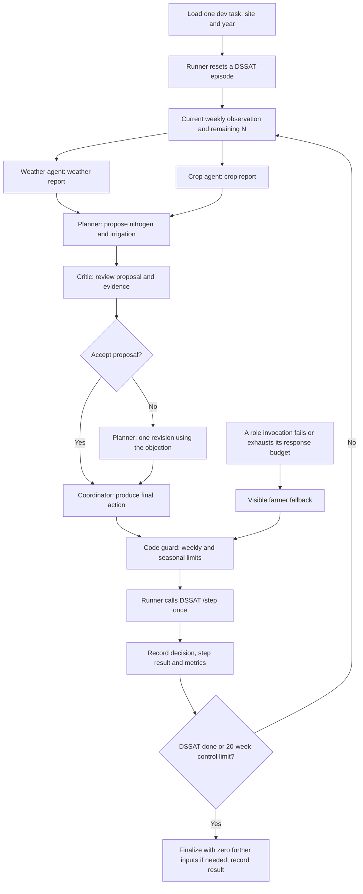

# Maize Runner

A team of five Nemotron agents that decides, week by week, how much nitrogen and water one maize field gets.

**Demo video:** https://www.youtube.com/watch?v=gxpolRO2nEU

**Headline (split test: 15 held-out Gainesville seasons, 2010-2024):** the five-agent team scores **$1,306.27/ha**
against **$1,074.14/ha** for farmer practice, a paired gain of **+$232.13/ha** (95% interval [$115.36, $348.89]).
It wins 12 of 15 seasons and has 0 fallback weeks. All results are simulated with gym-DSSAT, not field trials.

## Problem

Many farmers set fertilizer and water by calendar: the same doses on the same dates every season, whatever the
weather does. Our farmer-practice baseline is such a calendar (the UF 1982 experiment schedule: 116 kg N/ha and
264 mm of water every season). Its cost shows in three places:

- **Money.** On the test seasons, the team's profit is $223.95/ha higher than the calendar's (profit, before any
  leaching penalty).
- **Water.** The calendar irrigates 264.00 mm every test season. The team uses 93.80 mm less on average.
- **Leached nitrate.** Nitrate that drains below the roots is lost to the farmer and pollutes groundwater. The
  calendar leaches 23.04 kg N/ha per test season. The team leaches 3.35 kg/ha less.

## How it works

The field is one maize field in Gainesville, Florida, simulated by gym-DSSAT (the DSSAT CERES-Maize crop model)
on real NASA POWER weather, one real year per season. Planting is Feb 26 (day of year 57, as in gym-DSSAT's UFGA
experiment). Every week the team makes one decision: nitrogen (kg N/ha) and irrigation (mm). Each `/step` applies
the action on day 1 of the week, then simulates 7 days. On gym-DSSAT the season ends at crop maturity, usually
week 18-20 (stop when `/step` returns `done: true`; the toy simulator always runs 20 weeks).

Five roles share one Nemotron model, each with its own prompt and its own read tools:

| Agent | What it does |
|---|---|
| Weather | Reads the weather history and the noisy 7-day outlook. Reports expected rain, the risk that heavy rain leaches fresh nitrogen, and heat stress |
| Crop | Reads crop state and soil. Reports the growth stage, how much nitrogen the crop needs now, and soil water status |
| Planner | Proposes this week's nitrogen and irrigation from both reports and the agronomy guidance |
| Critic | Checks the proposal against the guidance and the reports. It accepts, or objects to one clear problem and names the change it wants |
| Coordinator | Makes the final call, usually the plan, and gives a one-line reason for the farmer |

Weather and Crop run in parallel. If the Critic objects, the Planner revises once, and the Coordinator gets the
revised plan with the review. A code guard then clamps the action to the field limits: N 0-120 kg/ha per week and
300 kg/ha per season, irrigation 0-50 mm per week. Values outside are clamped, not rejected, and `/step` returns
`"clamped": true`. If a role fails, the week falls back to a farmer schedule. Fallbacks are logged and counted,
never hidden. Role prompts include sourced UF/IFAS corn guidance (`agents_a/common/agronomy.md`).

What the agents see from the simulator:

| Field | Meaning on gym-DSSAT |
|---|---|
| `stage` | `VE` emergence, `V<n>` vegetative with n leaves (V1-V21), `R1` silking (~week 13), `R3` grain fill, `R6` maturity |
| `soil_water_frac` | plant-available water in the root zone: 0 = wilting point, 1 = field capacity |
| `soil_n_kg_ha` | **estimate** of soil mineral N (mass balance; this DSSAT build does not export soil nitrate) |
| `n_stress`, `water_stress` (`get_crop_state`) | 1 = no stress, 0 = severe stress |
| `gdd` | cumulative thermal time since planting (°C-days) |
| `biomass_kg_ha` | above-ground dry matter |
| `weekly.n_gas` / `final.n_gas` | denitrification + ammonia volatilization |
| `final.*` totals | counted from week 0 (pre-planting losses excluded), so they equal the sum of the weekly values |
| `get_weather` | `history` = last 14 observed days; `outlook` = the real next 7 days plus noise (rain x (1 + Normal(0, sd 0.4)), temperature + Normal(0, sd 2.0 °C)), seeded `year * 1000 + week` so every policy sees the same outlook |

The UI (`ui/`) has six pages: Season (3D replay and the live 2026 season), How it works, Results, Serving,
Agents and Gym.

## Results

### Score

`profit_usd_ha = grain_kg_ha * maize_price - n_applied * n_price - irr_mm * water_price`,
`reward = profit_usd_ha - leach_penalty * n_leached` (all per hectare). The score is the reward: profit minus a
penalty per kg of nitrate leached, in USD/ha per season. Higher is better. Prices are fixed in `config.yaml`, each
with its source:

| | value | source |
|---|---|---|
| maize | $0.193 per kg **dry** grain | USDA WASDE Apr 2026, 2025/26 season average $4.15/bu (15.5% moisture), converted to dry matter because DSSAT grain is dry |
| nitrogen | $1.66 per kg N | DTN retail, Sep 2026, UAN32 $483/short ton |
| irrigation | $0.565 per mm per ha | USDA NASS 2023 Irrigation and Water Management Survey, Florida pumping energy ($5.81/acre-inch) |
| leaching penalty | $2.44 per kg N leached | Sobota et al. 2015 (Environ. Res. Lett. 10:025006), Table 1, groundwater damage costs (2008 USD) |

One saved run per policy and season. Intervals are paired 95% normal intervals over seasons.

### Held-out test (split test: Gainesville FL, 15 seasons, 2010-2024; final design `d1c_multi`)

| | Farmer practice | Grid hindsight | Single agent | Five-agent team |
|---|---:|---:|---:|---:|
| Reward (USD/ha) | 1,074.14 | 1,265.22 | 1,237.97 | **1,306.27** |
| Irrigation (mm) | 264.00 | 124.27 | 156.60 | 170.20 |
| Nitrogen applied (kg/ha) | 116.00 | 135.73 | 212.07 | 204.07 |
| Nitrogen leached (kg/ha) | 23.043 | 12.917 | 21.245 | 19.689 |
| Fallback weeks | n/a | n/a | 11 | **0** |

- Team vs farmer practice (test): **+$232.13/ha**, 95% interval [$115.36, $348.89], 12/15 seasons won.
  Reward +21.61%, irrigation 35.53% lower, nitrogen leached 14.55% lower.
- Team vs grid hindsight (test): the team scores higher in 10 of 15 seasons (mean 1,306.27 vs 1,265.22).

### New site, never used for tuning (split tift_test: Tifton GA, 15 seasons, 2010-2024)

| | Farmer practice | Grid hindsight | Five-agent team |
|---|---:|---:|---:|
| Reward (USD/ha) | 1,062.94 | 1,270.78 | **1,297.29** |
| Irrigation (mm) | 264.00 | 140.40 | 157.13 |
| Nitrogen leached (kg/ha) | 21.81 | 14.05 | 17.95 |
| Fallback weeks | n/a | n/a | **0** |

- Team vs farmer practice (tift_test): **+$234.35/ha**, 95% interval [$120.18, $348.52], 12/15 seasons won.

### Team vs single agent (same model, same agronomy), two ways

| Seasons | Gain (USD/ha) | 95% interval | Seasons won | Fallback weeks (team / single) |
|---|---:|---:|---:|---:|
| test only (15) | +68.30 | [-6.10, 142.69] | 11/15 | 0 / 11 |
| dev-check 2005-2009 + test (20; neither design was tuned on them; shown in the UI) | +81.33 | [20.50, 142.16] | 15/20 | 0 / 15 |

The team makes about 3.01x as many model calls as the single agent (test).
Sources: `agents_a/designs/{d0b_single,d1c_multi}/results/eval.csv`, `results_baseline/eval.csv`.

### Baselines

Mean reward (USD/ha) on gym-DSSAT for all 35 seasons, frozen in `results_baseline/`:

| config | dev (20 seasons) | test (15 seasons) |
|---|---|---|
| `no_n` | 153 | 199 |
| `farmer` (60/60/40 kg N split + 25 mm when dry) | 1,024 | 1,096 |
| `farmer_ufga` = **farmer practice** (UF 1982 experiment schedule: 116 kg N, 264 mm) | 1,117 | 1,074 |
| `hindsight` = **grid hindsight** (best of 56 fixed plans with the weather known; not an upper bound) | 1,283 | 1,265 |

Farmer practice is set in `config.yaml` (`eval.farmer_practice`). It was chosen on dev only.

Grid hindsight picks the best of 56 fixed calendars with the weather known, but it cannot change a plan during the
season. The team adapts each week's nitrogen and water to the crop it observes and the forecast, so it can beat the
best fixed plan: on test it does in 10 of 15 seasons.

## Architecture and tech stack

Weekly decision flow (from [ARCHITECTURE.md](ARCHITECTURE.md), section 1):



[ARCHITECTURE.md](ARCHITECTURE.md) also has the deployed layout and marks proposed improvements separately from
what is built.

| Layer | What we use |
|---|---|
| Model | `nvidia/NVIDIA-Nemotron-3.5-Lightning-30B-A3B-BF16`, one checkpoint shared by all five roles |
| Serving | vLLM 0.27.1, OpenAI-compatible API, automatic tool calling, prefix caching (`scripts/serve_vllm.sh`) |
| Agents | Python: Weather, Crop, Planner, Critic, Coordinator (`agents_a/designs/d1c_multi/`), code guard on every action |
| Crop simulator | gym-DSSAT (DSSAT CERES-Maize), UFGA8201 maize experiment, behind a FastAPI env server (`env/server.py`) |
| Weather | NASA POWER daily data (`data/`) |
| RL environment | NVIDIA NeMo Gym wrapper around the env server (`gym_env/`) |
| UI | Plain JavaScript + three.js (vendored), served by `scripts/demo_server.py` (FastAPI / uvicorn) |
| Tooling | uv, pytest |

Why each part:

- **Nemotron 3.5 Lightning 30B:** the hackathon's 33B total-parameter limit allows one model, and this checkpoint
  handles tool calls, so one model can play all five roles (`agents_a/README.md`, `PERSON_B.md`).
- **vLLM:** one OpenAI-compatible endpoint with automatic tool calling (`qwen3_coder` parser), prefix caching for
  role prompts that stay identical across seasons, and up to 64 concurrent sequences, so parallel seasons share one
  server (`PERSON_B.md`, `results/b0-host.json`).
- **NeMo Gym:** wraps the same env server as a Gym environment (tasks, tools, verifier = final reward), so NeMo Gym
  and `eval/run_eval.py` always score the same thing (`gym_env/README.md`).
- **gym-DSSAT:** a published crop model (DSSAT CERES-Maize) behind a Gym interface, so nitrogen and water decisions
  get a real crop response. One season takes about 2 s.

### Interfaces

These contracts are fixed. Their original text is in `SKELETON_SPEC.md` (the reset body has since moved from
`weather_seed` to `year`).

**HTTP (env server, port 9000)**
- `POST /reset` `{task_id, site, year}` → `{episode_id, obs, week: 0}`. Unknown year → 400 `{error}`. The old
  `weather_seed` is still accepted (deprecated: maps to year 1990 + (seed - 1) mod 35); `year` wins when both are sent.
- `POST /step` `{episode_id, n_kg_ha, irr_mm, reason}` → `{obs, week, done, weekly, clamped}`, plus `final` when done.
- `GET /tool/{get_weather|get_crop_state|get_soil|get_history|get_budget}?episode_id=...`
- `GET /health` → `{ok: true, simulator}`. Unknown tool or episode → 404 `{error: "..."}` (written so an LLM can fix its call).
- `obs` = `{day, week, stage, soil_water_frac, soil_n_kg_ha, n_applied_total, irr_total_mm, biomass_kg_ha}`
- `weekly` = `{rain_mm, n_leached, n_uptake, n_gas}`
- `final` = `{grain_kg_ha, n_applied, n_uptake, n_leached, n_gas, irr_mm, profit_usd_ha, reward}`

**Policy interface**: `agents/policies/base.py` (see Agent runtime).

**Agent log** `runs/<config>/<task_id>.jsonl`, one object per line:
`{"t": iso_time, "week": int, "agent": "weather|crop|planner|critic|coordinator|policy|env", "kind": "...", "data": {...}}`.
Kinds: `tool_call`, `tool_result`, `message`, `decision` (`{n_kg_ha, irr_mm, reason}`), `fallback`, `step_result`
(the /step response), `final`. `runs/index.json` = `{"<config>": ["<task_id>", ...]}` lists runs for the UI.

**eval.csv columns**: `config, task_id, split, grain_kg_ha, n_applied, n_uptake, n_leached, n_gas, irr_mm, profit_usd_ha, reward, llm_calls, wall_s, fallbacks`.

**Simulator interface** (`env/sim_base.py`, for adding simulators): `reset(site, year)`, `step_week`, `weather_history`,
`weather_outlook`, `crop_state`, `soil_state`, `final`, optional `close`; register in `env/__init__.py`.

## Agent runtime

Two agent code paths share the env server, the guard rules and the log format:

- **Final design:** `agents_a/designs/d1c_multi/` is the evaluated team, run on dev, test and tift_test (results
  above). Other designs in
  `agents_a/designs/` (`d0_single`, `d0b_single`, `d1_multi`, `d1b_multi`, `d1d_multi`) are the single-agent
  baselines and earlier or ablated teams, each with its own README and results (`agents_a/README.md`). Every role
  is bounded to six model turns per call. `agents_a/common/guard.py` clamps every action in code and falls back to
  farmer practice (`farmer_ufga`) when the model fails.
- **Registered configs** (`agents/policies/`, engine in `fieldtwin_agents/`): `single`, `multi`,
  `multi_no_critic`, `multi_no_weather`, `multi_no_tools`.

| Config | Behavior |
| --- | --- |
| `single` | Coordinator alone with all five read tools |
| `multi` | Full five-agent team with one critic revision |
| `multi_no_critic` | Omit critic and revision |
| `multi_no_weather` | Omit Weather and disable get_weather for every role |
| `multi_no_tools` | Disable all model read tools; retain action submission |

The runtime enforces:

- **Action caps** from `config.yaml`: 120 kg N/ha per week, 50 mm per week, 300 kg N/ha per season. The final code
  guard also protects fallback weeks.
- **Role tool permissions:** each role gets only its assigned read tools.
- **At most one planner revision** after a Critic objection.
- **A visible farmer fallback** after two malformed model outputs in a row or a model HTTP failure (the `farmer`
  60/60/40 kg N split, 25 mm when soil water is below 0.35). Fallback weeks are logged and counted.

Default model backend is vLLM; set `FIELDTWIN_MODEL_BACKEND=stub` explicitly for software checks. Prompts are
frozen per version (`config/prompts-v1.freeze.json` and later candidates). The ablation configs above test the
team without the Critic, without Weather, and without read tools.

Evidence:
- Serving host record on the Brev H100 (image digest, model snapshot, GPU, launch arguments):
  [results/b0-host.json](results/b0-host.json).
- Tool-call smoke test against the live model: [results/b0-smoke.json](results/b0-smoke.json).
- Live-model checks on the toy simulator: [results/b1-b2-live.json](results/b1-b2-live.json),
  logs in [results/b1-b2-live-logs.zip](results/b1-b2-live-logs.zip).
- `fixtures/replay.nemotron-toy.{single,multi}.jsonl` are complete replay samples.

[Agent runtime and serving details](PERSON_B.md).

### Adding or changing a policy

1. **Get a simulator running**, locally (Quick start; toy if you cannot install gym-DSSAT) or on Brev. Point
   `config.yaml` `env.url` at it (default `http://localhost:9000`).
2. **Implement `Policy.decide`** (interface in `agents/policies/base.py`; examples in `agents/policies/single.py`,
   `multi.py` and the shared `nemotron.py` adapter):
   ```python
   class Policy(ABC):
       name: str
       def decide(self, episode_id, week, obs, env, log) -> Decision(n_kg_ha, irr_mm, reason): ...
   ```
   - Read tools with `self.call_tool(name, episode_id, week, env, log, agent="weather")`: it calls
     `GET /tool/<name>` and logs both the `tool_call` and `tool_result`. Tool schemas for the model (OpenAI format)
     are in `agents/tools.json`; `submit_decision` is the decision itself, so map the model's call to a `Decision`.
   - Log everything else with `log.event(week, agent, kind, data)`: `agent` in `weather|crop|planner|critic|coordinator`,
     `kind` in `message|fallback` (the runner logs `decision`, `step_result` and `final` for you).
   - Add 1 to `log.llm_calls` for every model call. Log a `fallback` event whenever you fall back (e.g. two malformed
     tool calls in a row -> farmer schedule for that week); fallbacks are counted and reported, never hidden.
   - Clamp in code, not in the prompt (the env also clamps and reports `clamped`).
3. **Register it** in `agents/policies/__init__.py` (`POLICIES = {"single": Single, "multi": Multi, ...}`) and add
   the name to `eval.configs` in `config.yaml`.
4. **Run it**: one season with `uv run python -m agents.run --policy single --task-id UFGA-1995`, then
   `uv run python -m eval.run_eval --split dev --configs farmer,single --limit 5`. `results/summary.md` reports
   reward with 95% CI, **gap closed** = (reward - farmer practice) / (hindsight - farmer practice), and leaching vs
   farmer practice. Baseline rows to compare against are in `results_baseline/eval.csv` (no need to rerun them).
   Eval runs `eval.parallel` seasons at once (8): each is one DSSAT process plus your model calls.
5. **Optional: score through NeMo Gym** with the real model instead of the dummy policy: `gym_env/README.md`
   (`--model-type vllm_model --model-url <vLLM>`).

## Serving performance

Dedicated H100, controlled run (split dev, `a_d1c_multi`, vLLM 0.27.1). The levels run the first 2, the first 8 and
all 20 dev seasons. Source: `results/vllm_metrics.json`, built by `lanec/scripts/vllm_metrics.py`.

| Concurrent seasons | Seasons | Model calls | Seasons/hour | Call p50 (ms) | Call p99 (ms) | Fallbacks |
|---:|---:|---:|---:|---:|---:|---:|
| 1 | 2 | 325 | 6.0 | 3,230 | 21,428 | 0 |
| 8 | 8 | 1,326 | 16.97 | 7,575 | 61,772 | 0 |
| 20 | 20 | 3,265 | 29.31 | 11,630 | 99,288 | 0 |

Throughput at 20 concurrent seasons is 4.9x the rate at 1 (29.31 vs 6.0 seasons/hour, dev). At 20 concurrent seasons
the prefix-cache hit rate is 65.79% and 38 requests run at peak. Seasons/hour includes inference, orchestration
and the CPU crop simulation. Latency grows with concurrency.

## Quick start and reproducing the demo

```bash
uv sync                                          # Python 3.11+ (uv picks it)
bash scripts/install_gym_dssat.sh                # once per machine, needs sudo; Ubuntu 22.04/20.04 or Debian 12

uv run uvicorn env.server:app --port 9000        # 1. env server (leave running)
uv run python -m agents.run --policy farmer --task-id UFGA-1995      # 2. play one season -> runs/farmer/UFGA-1995.jsonl
uv run python -m eval.run_eval --split dev --configs no_n,farmer,hindsight [--limit 3]   # 3. eval -> results/
python -m http.server 8080                       # 4. UI at http://localhost:8080/ui/ (from the repo root)
```

Checks: `uv run pytest` (contract tests on both simulators) and `bash scripts/smoke.sh` (prints PASS/FAIL).

**Model endpoint.** Set `VLLM_BASE_URL` (default `http://localhost:8000/v1`) and `VLLM_MODEL` in `.env` (copy
`.env.example`). The final team (`agents_a/`, including `run_design` and the live demo) loads `.env` automatically,
and exported shell variables win. The older `agents/` and `fieldtwin_agents/` policies read only exported shell
variables. `config.yaml` `agents.base_url_env` / `agents.model_env` name these variables.

Run the final agent team (needs the env server above and a Nemotron endpoint):

```bash
bash scripts/serve_vllm.sh                                   # on the GPU host: vLLM + Nemotron on port 8000
cp .env.example .env                                         # then set VLLM_MODEL (and VLLM_BASE_URL if not local)
uv run python -m agents_a.run_design --design d1c_multi --split dev --limit 1   # one dev season
```

`run_design` writes into `agents_a/designs/d1c_multi/runs/` and `.../results/{eval.csv,summary.md}`, which hold the
committed results. Run it in a fresh clone, or discard the changes afterwards (`git checkout -- agents_a/designs/`).

Live demo (plays the 2026 season live in the UI):

```bash
uv run python scripts/demo_server.py      # serves the UI at http://localhost:8080/ui/ and starts live runs
```

Open the Season page, pick 2026 and press Play. It needs the env server (port 9000) and vLLM (port 8000, or a
tunnel to it) running. Plain `python -m http.server` only replays recorded seasons and shows "Live server offline".
For the Brev GPU setup and resume commands, see [RUN_ON_BREV.md](RUN_ON_BREV.md).

### No gym-DSSAT on your machine?

Prefix any command with `FIELDTWIN_SIMULATOR=toy`, e.g. `FIELDTWIN_SIMULATOR=toy uv run uvicorn env.server:app --port 9000`.
The toy crop model has the same HTTP contract, tools, tasks and real weather; only the crop model is simpler.
It is fine for building and debugging agents. **Report numbers from gym-DSSAT only.**

### gym-DSSAT install notes

- `scripts/install_gym_dssat.sh` follows the official package install and puts gym-DSSAT in `/opt/gym_dssat_pdi`
  (its own Python 3.10). The project does not import it directly: `env/dssat_sim.py` starts one worker process per
  episode with that Python (`env/dssat_worker.py`).
- DSSAT embeds Python and would pick up a user-installed numpy 2.x from `~/.local`, which makes it hang.
  `dssat_sim.py` sets `PYTHONPATH` for the worker, so nothing to do; just don't remove that.
- One season takes about 2 s. Each episode holds one DSSAT process until the season ends.

## Data and provenance

- **Weather:** NASA POWER daily data, UFGA 1990-2024 (`data/`, see `data/README.md`); `scripts/fetch_power.py`
  regenerates it.
- **Crop:** gym-DSSAT's UFGA maize experiment (UFGA8201), moved to each task's year (`env/dssat_sim.py`).
  `scripts/validate_dssat_years.py` checks that DSSAT plays the right year. Toy fallback: `env/toy_sim.py`.
- **Prices:** real, each value cited in `config.yaml` (see Score above).
- **Tasks:** a task is a real (site, year). `tasks/dev.jsonl` = UFGA 1990-2009 (20 seasons), `tasks/test.jsonl` =
  UFGA 2010-2024 (15 seasons). Line format: `{"task_id": "UFGA-2015", "site": "UFGA", "year": 2015, "split": "test"}`.
  Dev is split again for checking prompt changes: dev-tune 1990-2004 and dev-check 2005-2009 (`agents_a/common/splits.py`).
- **Never tune on `test`.** Tune on `dev`; `test` is run once at the end.
- `tasks/tift_test.jsonl`: Tifton, GA 2010-2024 (15 seasons, split `tift_test`), a second site never used for tuning.
- `tasks/live.jsonl`: UFGA-2025 and UFGA-2026 (split `live`), played only live in the demo.
- `data/dssat_wth/*.WTH`: the DSSAT weather files built from NASA POWER, one per site and year (72 files, UFGA and TIFT),
  written by `scripts/fetch_power.py`.
- Forecast noise (agents' `get_weather` outlook only; the simulator uses the observed weather): rain x (1 + e) with
  e ~ Normal(0, sd 0.4), floored at 0; daily max and min temperature + Normal(0, sd 2.0 °C); seeded per season and
  week so every policy sees the same outlook (`env/sim_base.py` `noisy_outlook`, `config.yaml` `env.outlook_noise`).
- Results are simulated outcomes, not field trials.

## Repo map

- `env/`: `server.py` (HTTP API), `dssat_sim.py` + `dssat_worker.py` (gym-DSSAT), `toy_sim.py`, `weather.py` (NASA data loader), `sim_base.py`, simulator registry in `__init__.py`.
- `agents/`: `client.py` (env client), `tools.json` (tool schemas), `policies/` (registry, `no_n`, `farmer`, `farmer_ufga`, `nemotron_stub`, `single`, `multi` and ablations), `run.py` (season runner + logger).
- `agents_a/`: the evaluated designs (`designs/`), shared agent code (`common/`: model client, tool loop, guard, agronomy), `run_design.py`, `compare.py`, and `demo_results.json` for the UI's Results page.
- `fieldtwin_agents/`: the async multi-agent engine and experiment CLI behind `agents/policies/`, with versioned prompts.
- `eval/`: `hindsight.py` (grid hindsight: best fixed plan per season), `run_eval.py` (`results/eval.csv` + `results/summary.md`).
- `gym_env/`: NeMo Gym environment, see `gym_env/README.md`.
- `ui/`: the web UI (Season 3D replay and live season, How it works, Results, Serving, Agents, Gym).
- `results_baseline/`: frozen baseline results and season logs.
- `results/`: serving evidence, vLLM metrics (`vllm_metrics.json`) and archived experiment logs.
- `runs/`: exported agent logs for the UI (`runs/multi/`, `runs/index.json`).
- `tasks/`: season lists. `data/`: NASA POWER weather and DSSAT weather files (`scripts/fetch_power.py` regenerates them; see `data/README.md`).
- `config.yaml`: env URL, limits, outlook noise, prices and eval settings. `config/`: frozen prompt manifests.
- `scripts/`: `smoke.sh`, `install_gym_dssat.sh`, `serve_vllm.sh`, `fetch_power.py`, `validate_dssat_years.py`, `demo_server.py`, `live_season.py`, `build_demo_results.py`.
- `lanec/`: log validator and vLLM metrics scripts.
- `fixtures/`: replay samples. `tests/`: contract and pipeline tests.

## Limitations and next steps

- An episode abandoned mid-season keeps its DSSAT process until the env server restarts.
- `soil_n_kg_ha` on gym-DSSAT is a mass-balance estimate (see How it works); the reward does not use it.
- 2026 is one live run (split `live`): it is played once during the demo, and no 2026 result is stored or averaged.
- DSSAT reads two-digit years, so it simulates 2026 on stand-in year 2025 with the real 2026 weather
  (`env/dssat_sim.py` `dssat_year_for`); only the label and DSSAT's stored CO2 differ.
- Grid hindsight is not an upper bound: it is the best of 56 fixed plans, and the adaptive team beats it in 10 of 15
  test seasons.
- No RL training: the model weights are unchanged. Gains come from prompt and multi-agent design changes, scored by the
  direct runner; NeMo Gym wraps the same env server for evaluation.
- One saved run per policy and season; intervals do not include sampling noise across repeated runs.

Next steps:

- Reduce leaching in wet seasons, the final design's known weak spot (`agents_a/README.md`).
- Repeat runs per season to measure sampling noise.
- Improve the model itself through NeMo Gym rollouts; none have been run yet.

## Team

| Name | Role | GitHub |
|---|---|---|
| Darsh Rank | Simulator, env server, NeMo Gym environment, baselines, evaluation | [darshrank](https://github.com/darshrank) |
| Anandteertha Rao | Nemotron on vLLM, agent team, prompts, ablations | [anandteertha](https://github.com/anandteertha) |
| Sakhi Patel | UI, vLLM serving metrics, demo and submission | [sakhi20](https://github.com/sakhi20) |
