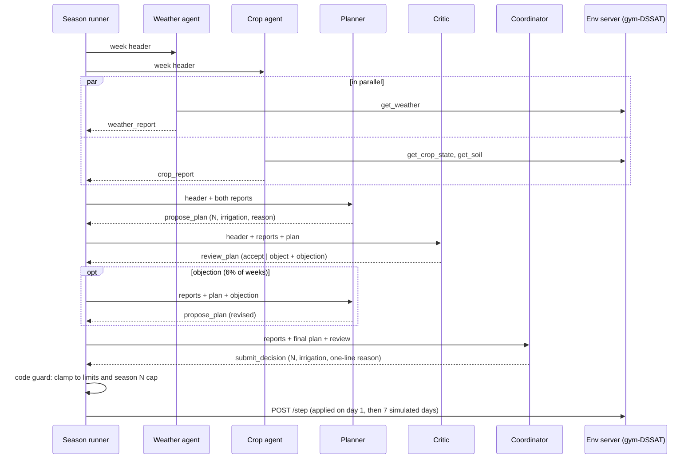

# d1c_multi architecture

A team of five agents (one model, five roles) manages one maize field for one season, one decision per week.
Best design so far: dev-tune mean reward 1,403 and dev-check 1,190, vs farmer practice 1,142 / 1,040
(gap closed 1.45 / 1.20; 17 of 20 dev seasons won). Numbers below are measured from its 20 dev season logs.

## 1. System context

```
NASA POWER daily weather (open data) ──► data/weather/*.json, data/dssat_wth/*.WTH
                                                   │
┌──────────────────────────────────────────────────▼──────────────────────────┐
│ FieldTwin env server (env/server.py, :9000)                                 │
│   gym-DSSAT CERES-Maize, UFGA experiment moved to the task's year           │
│   POST /reset {task_id, site, year}   POST /step {n_kg_ha, irr_mm, reason}  │
│   GET /tool/get_weather | get_crop_state | get_soil | get_history | get_budget
└──────────────────────────────▲──────────────────────────────────────────────┘
                               │ HTTP: read tools + one weekly decision
┌──────────────────────────────┴──────────────────────────────────────────────┐
│ Season runner (agents/run.py play_season)                                   │
│   for each week: decision = MultiAgentC.decide(...) ; POST /step ; log      │
│                                                                             │
│ MultiAgentC (d1c_multi/policy.py -> d1_multi/policy.py flow)                │
│   Weather ─┐                                                                │
│            ├─► Planner ─► Critic ─(object?)─► Planner revise ─► Coordinator │
│   Crop ────┘                                                                │
│   + code guard (agents_a/common/guard.py)                                   │
└──────────────────────────────┬──────────────────────────────────────────────┘
                               │ OpenAI-compatible chat completions + tool calling
┌──────────────────────────────▼──────────────────────────────────────────────┐
│ vLLM on Brev H100 (fieldtwin-b0), reached via `brev port-forward ... 8000`  │
│   nvidia/NVIDIA-Nemotron-3.5-Lightning-30B-A3B-BF16                         │
│   --enable-auto-tool-choice --enable-prefix-caching --max-num-seqs 64       │
│   --max-model-len 16384                                                     │
└─────────────────────────────────────────────────────────────────────────────┘
Outputs: runs/a_d1c_multi/<task>.jsonl (every message, tool call, decision) -> results/eval.csv -> UI replay
```

**Model budget:** every agent is the same Nemotron 3.5 Lightning (30B total, 3B active). The hackathon caps the
total parameters of all generative models at 33B, so the team differs by role (prompt, tools, output schema),
not by model.

## 2. One week, step by step



1. **Week header** (code, `common/season.py`): week, days after planting, stage, soil water, soil N, N and
   irrigation applied so far, biomass. Every role gets it, so nobody needs the whole season history.
2. **Weather and Crop run in parallel** (two threads), each with only its own tools.
3. **Planner** turns the two reports into a proposal.
4. **Critic** reviews it against the agronomy rules; objects with one concrete change, or accepts.
5. **Planner revises once** if the Critic objected (no endless loop).
6. **Coordinator** makes the final call and writes the one-line reason the farmer (and the UI) shows.
7. **Code guard** clamps the action; the runner sends it to the simulator.

## 3. The agents

All roles get the same three prompt blocks, in this order: `prompts/context.md` (team, scoring, limits, stage
names; prices filled from `config.yaml`), `agents_a/common/agronomy.md` (sourced UF/IFAS agronomy), then the
role file. Each role answers by calling its **answer tool**, so its output is structured.

| role | read tools | answer tool and fields | prompt | what it decides |
|---|---|---|---|---|
| Weather | `get_weather` | `weather_report`: rain_next_3d_mm, rain_next_7d_mm, heavy_rain_risk (low/medium/high), heat_stress, summary | `weather.md` | rain and heat outlook from a noisy 7-day forecast |
| Crop | `get_crop_state`, `get_soil` | `crop_report`: stage, n_demand (low/medium/high, none from VT on), water_status (dry < 0.5 / ok / wet > 0.9), summary with the numbers | `crop.md` | how much N and water the crop needs now |
| Planner | `get_history`, `get_budget` | `propose_plan`: n_kg_ha, irr_mm, reason | `planner.md` | season N ~220-230 kg/ha in small doses, none after VT; irrigation sized to crop water use (35-50 mm at peak minus expected rain) when soil water < 0.5 from late vegetative to grain fill |
| Critic | `get_budget`, `get_soil` | `review_plan`: verdict (accept/object), objection | `critic.md` | objects only to clear errors: N after VT or above ~230 total, > 60 kg in one week, N before heavy rain (split/delay, never starve), under-irrigation, irrigating a wet soil or before rain |
| Coordinator | none | `submit_decision`: n_kg_ha, irr_mm, reason | `coordinator.md` | final call, usually the plan; one-line reason |

A role may call its read tools several times; a call to any other tool returns an error message telling it which
tools it has (the agent can recover).

## 4. Role loop (`agents_a/common/agent.py`)

```
messages = [system prompt, user message]
repeat up to 6 model calls:
    reply = Nemotron(messages, tools = role's read tools + answer tool)
    no tool call       -> remind "answer by calling <answer tool>"   (bad += 1)
    answer tool        -> required fields present? return them        (else bad += 1)
    allowed read tool  -> run it on the env server, append the result (bad = 0)
    other tool         -> error message                               (bad += 1)
    bad == 2           -> give up (return None)
give up after 6 calls
```

Every model call and every tool call is logged with the role's name (`agent` field of the frozen log format).

## 5. Guards and fallbacks (never crash a season, never hide a failure)

| failure | what happens |
|---|---|
| Weather or Crop gives up | its report is "unavailable"; the team continues |
| Planner gives up | that week uses the farmer-practice schedule (`farmer_ufga`), logged as `fallback` |
| Critic gives up | treated as accept ("critic unavailable") |
| Coordinator gives up | the Planner's final plan is used |
| any model error (server down, timeout) | handled by the rule for that role above |
| out-of-range action | clamped in code: 0-120 kg N/week, 300 kg N/season, 0-50 mm/week |
| vLLM or simulator down before a run | `run_design.py` preflight stops the run instead of silently falling back |

Fallbacks in the 20 dev seasons: **0**.

## 6. Measured cost (20 dev seasons, 377 weeks)

| role | model calls per week | prompt tokens (mean / max) | completion tokens (mean) | latency per call |
|---|---|---|---|---|
| Weather | 2.00 | 1,751 / 2,108 | 298 | 4.9 s |
| Crop | 2.87 | 1,663 / 1,906 | 354 | 5.5 s |
| Planner | 1.13 | 1,823 / 2,320 | 872 | 12.5 s |
| Critic | 1.63 | 1,872 / 2,125 | 1,449 | 19.9 s |
| Coordinator | 1.00 | 1,679 / 1,934 | 391 | 5.6 s |

- About **8.6 model calls per week, 163 per season**; every prompt stays under 2,400 tokens (limit 16,384), because
  each role sees only the week header, the reports it needs and its own tool results.
- Critic objections: **22 of 372 reviews (6%)**, so the revise step is rare.
- About 20 minutes per season with 8 seasons in parallel on the shared H100 (latency is mostly Nemotron reasoning;
  the Critic reasons longest). Identical role prompts across seasons are what vLLM prefix caching reuses.
- A few replies hit the 4,096-token limit while reasoning (Crop, Planner, Critic); the role loop recovers by asking
  again, so they cost time but not decisions.

## 7. Code map

| file | what |
|---|---|
| `agents_a/designs/d1c_multi/policy.py` | `MultiAgentC`: d1_multi flow + agronomy inserted into every role prompt |
| `agents_a/designs/d1_multi/policy.py` | the week flow (`decide`), answer-tool schemas, prompt loading |
| `agents_a/designs/d1c_multi/prompts/` | `context.md`, `weather.md`, `crop.md`, `planner.md`, `critic.md`, `coordinator.md` |
| `agents_a/common/agronomy.md` | sourced agronomy shared by all roles (UF/IFAS, extension sources) |
| `agents_a/common/agent.py` | role loop |
| `agents_a/common/llm.py` | vLLM client (temperature 0, max 4,096 tokens, up to 3 attempts per call); logs every call with tokens and latency |
| `agents_a/common/guard.py` | clamp and farmer-practice fallback |
| `agents_a/common/season.py` | week header, history table, tool-result truncation (1,500 chars) |
| `agents_a/run_design.py` | runs a design on a split into its folder; `agents_a/compare.py` compares designs |

## 8. Known weaknesses (next design candidates)

- **Leaching in wet seasons:** 1991 (44.6 kg N/ha), 1996 (43.0), 2005 (55.8). Average leaching 18.7 kg/ha vs 14.2
  for hindsight.
- **Driest season:** 1998 slightly below farmer practice (361 vs 377).
- **Speed:** the Critic's long reasoning is the slowest step (~20 s per call).
- **Fair single-agent comparison still to run:** `d0_single` used the first prompt; `d0b_single` (one agent with the
  same sourced agronomy) is needed to show the gain comes from the team, not only the prompt.

## 9. Run it

```bash
uv run uvicorn env.server:app --port 9000
brev port-forward fieldtwin-b0 -p 8000:8000
uv run python -m agents_a.run_design --design d1c_multi --split dev --subset tune   # or check, or --task-id UFGA-1999
```
